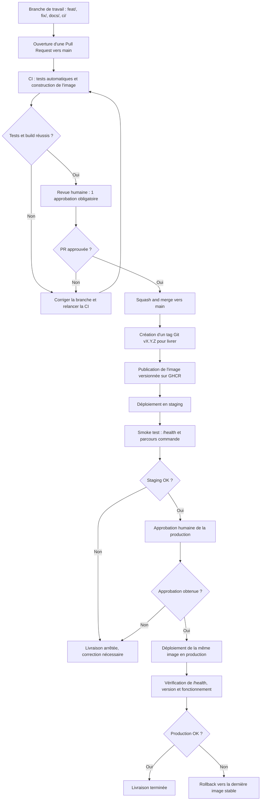

# T4 — Conception du pipeline CI/CD

## 1. Objectif et schéma du pipeline

Notre équipe utilise **GitHub Flow** : chaque modification passe par une Pull Request (PR) vers `main`. La fusion dans `main` ne déploie **pas** automatiquement en production. La livraison est déclenchée par un **tag Git versionné** (`v1.1.0`, par exemple). Ce fonctionnement évite de reproduire l'ancien déploiement automatique sans vérification (R2, R3, R5).

**Points de validation humaine :** (1) un membre différent de l'auteur approuve la PR avant sa fusion (R1, R2) ; (2) un permanent autorisé approuve le passage de staging en production (R3). Si la protection d'environnement GitHub n'est pas disponible, cette validation est documentée et le déploiement reste réservé à une personne autorisée.

## 2. Étapes, déclencheurs et blocages

Les durées ci-dessous sont des **estimations pour notre petite API** ; elles seront ajustées après les premiers essais.

| Étape | Déclencheur | Durée estimée | Bloquante ? |
|---|---|---:|---|
| Tests automatiques + build de vérification | Ouverture ou mise à jour d'une PR | 2 à 4 min | **Oui** : pas de fusion si échec (R3) |
| Revue de code (1 approbation) | CI réussie et PR prête | Objectif : réponse sous 4 h ouvrées | **Oui** : pas de fusion sans approbation (R1, R2) |
| Fusion dans `main` | CI verte + approbation | 1 min | **Oui** : condition préalable à la livraison (R2) |
| Publication de l'image Docker versionnée dans GHCR | Création d'un tag `vX.Y.Z` | 2 à 4 min | **Oui** : pas de déploiement sans image identifiée (R5) |
| Déploiement en staging | Image publiée | 1 à 2 min | **Oui** : production interdite si échec (R3) |
| Smoke test en staging (`/health`, produits, commande) | Staging déployé | 1 à 2 min | **Oui** : production interdite si échec (R3) |
| Approbation humaine de production | Smoke test réussi | Variable selon disponibilité | **Oui** : aucune production sans accord (R3) |
| Déploiement en production | Approbation obtenue | 1 à 2 min | **Oui** : échec = arrêt et investigation (R3) |
| Vérification après déploiement (`/health`, version, commande) | Production déployée | 1 min | **Oui** : échec = déclenchement du rollback (R3, R5) |

Les mises en production ordinaires sont évitées **du vendredi 14 h au lundi matin**. Seul un hotfix critique peut faire exception, avec justification et validations maintenues (R3).

## 3. Procédure de retour arrière (rollback)

**Qui décide ?** Un des deux développeurs permanents, après constat d'une erreur en production (par exemple `/health` en échec ou commandes bloquées). Il prévient l'équipe et note l'incident (R3, R5).

**Comment ?**

1. Identifier la **dernière version stable** grâce au tag Git, à l'image GHCR et à l'historique des déploiements (R5).
2. Redéployer **la même image Docker stable déjà publiée**, sans reconstruire le code et sans utiliser `latest` (R5).
3. Vérifier que `/health` répond, que la version affichée correspond au tag restauré et qu'une commande de contrôle fonctionne (R3, R5).
4. Documenter la panne et ouvrir une branche `hotfix/*` pour corriger la cause, avec PR, tests et revue habituels (R2, R3).

**Temps visé : moins de 5 minutes**, à partir de la décision de rollback, si l'image stable est disponible et si la base reste compatible. Cet objectif devra être démontré lors de la partie 2 (R5).

**Ce que le rollback ne sait pas annuler :** les commandes et données déjà écrites en base, les migrations PostgreSQL destructives, ni les effets externes déjà déclenchés (par exemple une notification envoyée). Les migrations doivent donc être versionnées, testées en staging et compatibles avec la version précédente de l'API (R5).

## 4. Responsabilités

- **Développeur auteur de la PR :** écrit le code et les tests, corrige les échecs CI (R2, R3).
- **Relecteur disponible et compétent :** valide la PR ; pendant les semaines d'école, les deux permanents peuvent se relire (R1, R2).
- **Permanent autorisé :** valide la production, surveille le résultat et déclenche le rollback si nécessaire (R3, R5).
- **Freelance :** suit le même circuit PR + CI + revue, sans dérogation (R2).

> **Périmètre T4 :** ce document décrit le fonctionnement prévu. Les workflows GitHub Actions et les déploiements réels seront mis en place et testés ensuite, en T5 et en partie 2.
