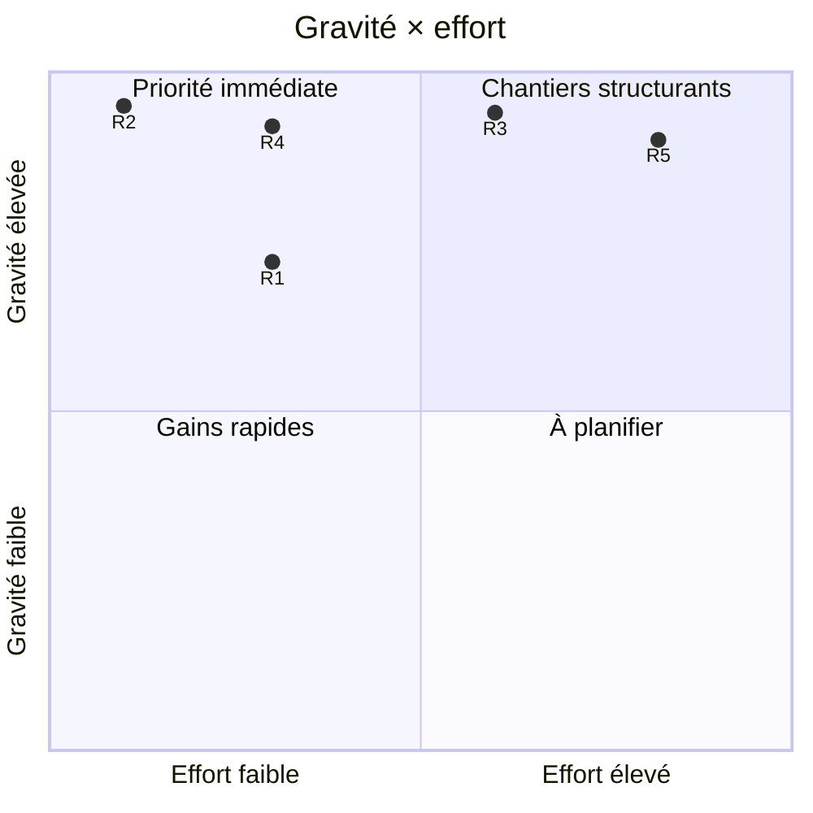

# T1 — Analyse des risques

## 1. Contexte

Notre entreprise est une start-up qui met en relation des producteurs, des restaurants et des particuliers. Elle repart sur un dépôt GitHub public après plusieurs pratiques risquées : push directs sur `main`, déploiements automatiques sans tests, images Docker identifiées uniquement par `latest`, secrets dans un fichier `.env` versionné et migrations PostgreSQL exécutées manuellement.

Lors de l'incident d'août, une mise en production effectuée un vendredi à 19 h a bloqué les commandes pendant **14 heures**. L'équipe ne savait pas quelle version était déployée.

**Carte contexte :** l'équipe compte **2 développeurs permanents et 2 alternants**, présents en entreprise **2 semaines sur 4**. Pendant leurs semaines de formation, seuls les 2 permanents assurent la continuité. Le scénario mentionne également une lead dev préoccupée par la lenteur des revues, un Product Owner qui souhaite livrer rapidement, une CEO qui refuse une nouvelle panne majeure et un freelance ponctuel qui ne veut pas attendre les relectures.

## 2. Identification des 5 risques

### R1 — Absence des alternants et perte de connaissances

- **Origine :** carte contexte (2 alternants absents 2 semaines sur 4) et crainte de ralentissement exprimée par la lead dev.
- **Catégorie :** Organisation.
- **Scénario concret :** un alternant commence une fonctionnalité puis repart en formation sans expliquer son travail. Les permanents ne savent pas la terminer. Si deux approbations étaient exigées par Pull Request, les deux personnes présentes certaines semaines pourraient difficilement faire avancer les changements.
- **Gravité : 4/5 (élevée).** Le risque ralentit les livraisons et peut retarder une correction urgente.
- **Mesure dans le futur socle :** découper les travaux en petites issues GitHub, ouvrir une *Draft Pull Request* pour le travail inachevé et prévoir une passation avant le départ en formation. Exiger **une approbation par PR**, donnée par une personne disponible et compétente sur le changement. Les deux permanents se relisent mutuellement pendant les semaines d'absence des alternants. Documenter les procédures dans `CONTRIBUTING.md`.

### R2 — Modification de `main` sans relecture

- **Origine :** ancienne pratique des push directs sur `main` ; inquiétude de la lead dev concernant les revues ; freelance souhaitant éviter l'attente.
- **Catégorie :** Fiabilité et organisation.
- **Scénario concret :** pour livrer vite, un développeur ou le freelance pousse un changement non relu sur `main`. Une régression affectant les commandes est fusionnée puis livrée en production.
- **Gravité : 5/5 (critique).** Une modification non vérifiée peut interrompre le service et entraîner des pertes commerciales.
- **Mesure dans le futur socle :** protéger `main` avec une règle GitHub imposant une Pull Request, **une approbation** et le succès des contrôles CI avant fusion. Appliquer la règle aux administrateurs lorsque la configuration du dépôt le permet ; ne pas accorder de droits d'administration au freelance. Fixer un objectif interne de relecture sous **4 heures ouvrées**, avec réattribution si le relecteur est absent. Cet objectif relève de la discipline de l'équipe, contrairement aux contrôles imposés par GitHub.

### R3 — Déploiement sans tests ni validation au mauvais moment

- **Origine :** déploiement automatique par SSH à chaque push, tests insuffisants et incident d'août (vendredi 19 h, 14 heures de panne) ; exigence de fiabilité de la CEO.
- **Catégorie :** Fiabilité.
- **Scénario concret :** une modification casse `POST /orders`. Le code est déployé automatiquement un vendredi soir sans tests ni vérification, empêchant les clients de commander alors que peu de personnes sont disponibles pour intervenir.
- **Gravité : 5/5 (critique).** Ce type d'incident s'est déjà produit et a bloqué l'activité pendant 14 heures.
- **Mesure dans le futur socle :** exécuter automatiquement les tests avec GitHub Actions sur les PR et bloquer la fusion en cas d'échec. Tester la version sur un environnement de *staging* avec un *smoke test*, puis demander une approbation humaine avant le déploiement en production. Éviter les déploiements ordinaires du vendredi à 14 h jusqu'au lundi ; autoriser un **hotfix critique** après validation et avec une procédure de retour arrière prête. La restriction horaire est une règle d'organisation à respecter et à documenter.

### R4 — Exposition de secrets dans le dépôt public

- **Origine :** ancienne pratique de versionnement d'un fichier `.env` contenant des mots de passe et clés d'API ; dépôt GitHub public.
- **Catégorie :** Sécurité.
- **Scénario concret :** un membre commite par erreur des identifiants PostgreSQL dans `.env`. Une personne extérieure récupère ces secrets et peut tenter d'accéder aux services ou aux données de l'entreprise.
- **Gravité : 5/5 (critique).** Une fuite peut compromettre des données et l'infrastructure, avec des conséquences réglementaires possibles.
- **Mesure dans le futur socle :** exclure `.env` via `.gitignore` dès le départ et fournir un `.env.example` sans secret réel. Stocker les secrets du pipeline dans **GitHub Actions Secrets / Environments** et les secrets du serveur dans une configuration sécurisée hors Git. Ajouter un contrôle de détection des secrets dans la CI. En cas de fuite, **révoquer et renouveler immédiatement** les identifiants, vérifier les accès et traiter l'historique Git ; effacer un commit ne suffit pas à rendre un secret sûr.

### R5 — Version inconnue, migrations non maîtrisées et rollback impossible

- **Origine :** images Docker publiées avec `latest`, absence de traçabilité de la version en production lors de l'incident d'août et migrations de base lancées manuellement « quand on y pense ».
- **Catégorie :** Fiabilité et exploitation.
- **Scénario concret :** une nouvelle version de l'API nécessite une colonne `stock`, mais la migration PostgreSQL est oubliée. Les commandes échouent. L'équipe ne connaît pas la version précédente et une migration incompatible peut empêcher de restaurer rapidement l'application.
- **Gravité : 5/5 (critique).** La panne peut durer plusieurs heures et le retour arrière peut être bloqué par le schéma de la base.
- **Mesure dans le futur socle :** identifier chaque livraison par un **tag Git**, une image Docker versionnée publiée sur **GHCR** et un identifiant de commit ; exposer la version active sur `GET /health` pour la retrouver en moins de 10 secondes. Conserver la dernière image connue comme stable et tester un **rollback applicatif en moins de 5 minutes**. Versionner les migrations, les exécuter dans une **étape dédiée et contrôlée du pipeline**, les tester en staging et privilégier des changements de schéma rétrocompatibles. Un rollback applicatif ne restaure pas automatiquement les données modifiées.

## 3. Matrice gravité × effort

**Échelle de gravité :** 1 = faible ; 2 = modérée ; 3 = importante ; 4 = élevée ; 5 = critique.

**Échelle d'effort de traitement :** 1 = très faible ; 2 = faible ; 3 = moyen ; 4 = élevé ; 5 = très élevé.

| Risque | Gravité | Effort | Justification du positionnement |
|---|---:|---:|---|
| **R1 — Absence des alternants** | **4/5** | **2/5** | La moitié de l'équipe est absente deux semaines sur quatre : les blocages peuvent être importants. Les passations, petites PR et règles de relecture sont peu coûteuses à instaurer. |
| **R2 — Push sur `main` sans relecture** | **5/5** | **1/5** | Une erreur peut casser les commandes. La protection de branche et l'exigence d'une approbation demandent principalement de la configuration GitHub. |
| **R3 — Déploiement sans tests** | **5/5** | **3/5** | Le risque a déjà causé 14 heures d'arrêt. Écrire les tests, configurer la CI, le staging et la validation de production demande un effort moyen. |
| **R4 — Fuite de secrets** | **5/5** | **2/5** | Une fuite dans un dépôt public peut être grave. `.gitignore`, secrets hors Git et détection automatisée sont relativement simples à mettre en place, même si la gestion d'une fuite reste complexe. |
| **R5 — Version, migrations et rollback** | **5/5** | **4/5** | L'absence de version connue prolonge les pannes. La traçabilité des images, les migrations compatibles et un rollback testé en moins de 5 minutes nécessitent plusieurs mécanismes coordonnés. |

La matrice met en évidence deux **gains rapides critiques** (R2 et R4), deux **chantiers structurants critiques** (R3 et R5) et un **risque organisationnel élevé** à traiter dès le début (R1).

## 4. Priorisation

1. **R2 et R4 — Sécuriser immédiatement le dépôt :** protéger `main` et empêcher la publication de secrets.
2. **R1 — Assurer la continuité du travail :** mettre en place les passations et une relecture réalisable avec seulement deux permanents présents.
3. **R3 — Fiabiliser les livraisons :** ajouter les tests, le staging et l'approbation de production.
4. **R5 — Préparer la reprise après incident :** tracer les versions, contrôler les migrations et démontrer un rollback en moins de 5 minutes.

## 5. Conclusion

Ces cinq risques découlent des pratiques historiques de l'entreprise, de l'incident d'août, des attentes des parties prenantes et de notre carte contexte. Notre futur socle DevOps reposera sur des Pull Requests contrôlées, des tests automatisés, une gestion sécurisée des secrets, une traçabilité des versions et des procédures de passation et de rollback. Chaque règle sera reprise et justifiée dans les documents de stratégie de branches, de contribution et de pipeline.
